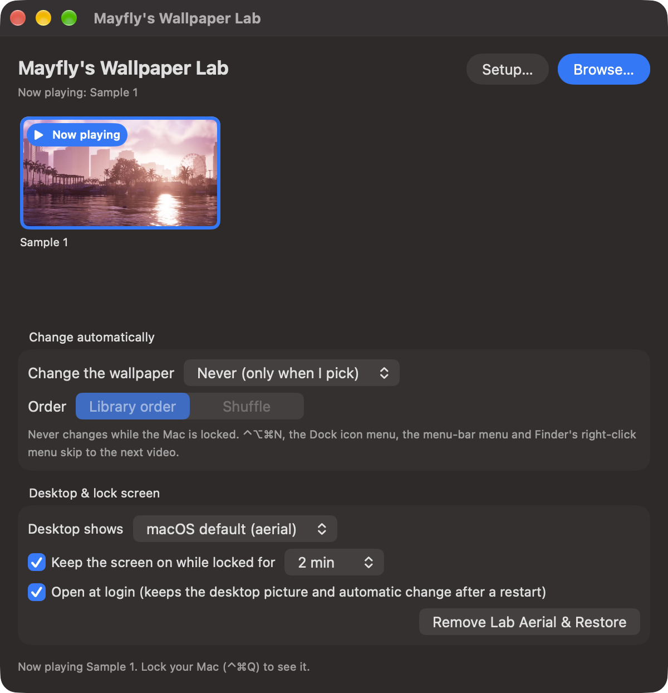

# Mayfly's Wallpaper Lab

Play your own videos on the macOS lock screen, with the same smooth slow-motion stop as Apple's aerials.



macOS can play moving wallpapers called *aerials* on the lock screen, but only Apple's own clips. Mayfly's Wallpaper
Lab adds one extra aerial to that list and fills it with a video you choose. The lock screen then plays your video
exactly the way it plays Apple's: it moves while the Mac is locked, and when you unlock it slows down and comes to a
stop.

## Contents
- [Features](#features)
- [Requirements](#requirements)
- [Install](#install)
- [Using it](#using-it)
- [How it works](#how-it-works)
- [Known limitations](#known-limitations)
- [Troubleshooting](#troubleshooting)
- [Uninstall](#uninstall)
- [Build from source](#build-from-source)
- [Contributing](#contributing)
- [Disclaimer](#disclaimer)
- [License](#license)

## Features
- **Any video as your lock screen.** MP4, MOV and M4V files work. Each video is converted once, in the background,
  into the format macOS needs. You can move or delete the original afterwards.
- **Smooth unlock.** Videos are converted to 4K at 240 frames per second, the format of Apple's aerials. The extra
  frames are what the slow-motion stop on unlock plays; they are generated by macOS's own frame interpolation, so
  the stop is smooth rather than jerky.
- **A library.** Keep as many videos as you like and switch with one click.
- **Automatic change.** Every time you unlock, every 15 minutes, hourly, daily and more; in order or shuffled.
- **Next wallpaper anywhere.** Press ⌃⌥⌘N (Control-Option-Command-N), or use the menu-bar icon, the Dock icon's
  menu or Finder's right-click menu.
- **Choose what the desktop shows.** The video's first frame, a picture of your own, or macOS's default.
- **Keeps the lock screen on.** macOS normally turns the display off a few seconds after you lock. The app can keep
  it on for 1 to 30 minutes so you actually see the video.
- **Leaves Apple's files alone.** Apple's aerials are never changed, and one button removes everything the app
  added.
- **No extra software.** Uses only what is built into macOS.

## Requirements
- A Mac with Apple silicon (M1 or later).
- macOS 27. It was built and tested on macOS 27.0.1.

## Install
The app is free and not signed by a registered Apple developer, so the first time you open it macOS will block it.
You only need to allow it once.

1. Download `Mayfly's Wallpaper Lab.zip` from the [Releases](../../releases) page and double-click it to unzip.
2. Drag **Mayfly's Wallpaper Lab** into your **Applications** folder. Open it from there, not from Downloads:
   macOS runs apps opened from Downloads from a temporary copy, which breaks the login item and the Finder menu.
3. Double-click the app. macOS says it can't check it for malicious software. Click **Done**.
4. Open **System Settings → Privacy & Security**, scroll down to the message saying *Mayfly's Wallpaper Lab was
   blocked*, and click **Open Anyway**. Confirm with your password or Touch ID.

   If you prefer Terminal, this one command does the same as steps 3 and 4:
   ```bash
   xattr -dr com.apple.quarantine "/Applications/Mayfly's Wallpaper Lab.app"
   ```
5. The app opens with a short **Setup** checklist. Each item ticks itself once it's done:
   - **Running from the Applications folder.** Ticked if you followed step 2.
   - **Apple's aerials are on this Mac.** The app's aerial is modelled on one of Apple's, so at least one Apple
     aerial must have been downloaded. If this isn't ticked, click **Open Wallpaper Settings**, click any aerial
     (for example under Landscape) and wait for it to download.
   - **Finder right-click menu** (optional). Click **Open Extensions** and turn on Mayfly's Wallpaper Lab.
   - **Open at login** (optional). Keeps automatic changes working after a restart. macOS shows a "Background item
     added" notice when you turn it on.

That's all. The app needs no Accessibility, Screen Recording or Full Disk Access permission and never asks for an
administrator password. You can open the checklist again any time with **Setup…** in the app window.

## Using it
1. Click **Browse…** and choose one or more videos.
2. Wait for the conversion. The tile shows its progress; it takes a few minutes per video, and the Mac stays usable
   meanwhile.
3. Click a video's tile to make it your wallpaper. If no wallpaper is set yet, the first video to finish converting
   is set automatically.
4. Lock your Mac (Control-Command-Q) to see it. Unlock to watch it slow down and stop.

Right-click a tile to remove it from the library or show the original file. The app keeps running in the menu bar
(the flask icon) after you close its window.

**Tips**
- Landscape videos look best. Other shapes are scaled to fill the screen and the edges are cropped.
- 60 fps videos give the smoothest unlock (see [Known limitations](#known-limitations)).
- Short clips are fine: they are repeated to fill five minutes.

## How it works
**In short:** the app adds its own entry to macOS's list of aerials, places your converted video where macOS keeps
downloaded aerials, and points your wallpaper at that entry. macOS then plays it with its own player, exactly as it
plays Apple's aerials.

### Adding the aerial
macOS keeps its aerials in `~/Library/Application Support/com.apple.wallpaper/aerials/`.

1. **The list.** `manifest/entries.json` lists every aerial. The app adds one entry, copied from an Apple aerial
   that is already downloaded and given its own ID, name and address. It has to be a copy: macOS silently ignores
   a hand-made entry and falls back to another aerial.
2. **The video.** The converted video goes in `videos/` under the entry's ID, tagged the way macOS tags aerials it
   downloaded itself. Without those tags macOS would try to download the video from the entry's address, which
   deliberately points nowhere.
3. **The wallpaper setting.** The app points the wallpaper setting (`Store/Index.plist`) at the new entry and
   restarts the wallpaper process so the change shows straight away.

When Apple publishes a new list of aerials, macOS replaces `entries.json` and the app's entry disappears. The app
checks when it opens and every 10 minutes, and adds the entry back if needed.

### Converting the video
macOS's lock-screen player expects videos in exactly the shape of Apple's aerials:

- **4K (3840×2160), 10-bit HEVC (the video format Apple's aerials use), at 239.76 frames per second.** The video
  is scaled to fill the screen and centred. Most videos have far fewer frames, so the missing ones are generated
  with macOS's built-in frame interpolation (machine learning), rather than repeated, which keeps the slow-down
  smooth. On a Mac without it, frames are
  repeated instead.
- **Frames sorted into five levels.** This is what makes the unlock smooth. At normal speed the player needs only
  a fraction of the 240 frames per second, so it plays just the lower levels. On unlock it slows the video down,
  and a slower video needs more frames per second of footage to stay fluid, so the player adds the higher levels
  one by one as it slows. Playback glides to a stop instead of jumping.

  macOS's built-in video encoder can only make four levels, and labels them in a way the player doesn't accept.
  So after encoding, the app re-labels the frames into the five-level layout that Apple's aerials use. Only the
  labels change, not the picture, so this takes seconds and loses no quality. Without this step the unlock
  stutters and flashes grey.

The technical details are in [`Sources/Layers.swift`](Sources/Layers.swift). In brief: it keeps the encoder's levels
0–2, splits level 3 into levels 3 and 4, marks every frame above level 0 as a layer switch point (TSA), declares five
layers in the `hvcC` box and the VPS/SPS, and sorts the file's level table (`tscl`), which the player reads in
order. The rest is in [`Sources/Engine.swift`](Sources/Engine.swift) (the aerial entry) and
[`Sources/Convert.swift`](Sources/Convert.swift) (the conversion).

All of this was worked out by experiment and from macOS's own logs, because Apple doesn't document it.

## Known limitations
- **It relies on undocumented macOS behaviour.** A macOS update can break it until the app is updated. Check the
  [Releases](../../releases) page if it stops working after an update.
- **The entry can briefly vanish.** When Apple publishes a new aerial list, the wallpaper can fall back to an Apple
  aerial for up to 10 minutes, until the app restores its entry.
- **The frame the unlock stops on.** When the video comes to a stop on unlock, the frame it stops on is sometimes
  one of the generated in-between frames rather than a frame from your original video. With 60 fps videos this
  never happens; with 30 fps videos it happens about half the time and is usually invisible.
- **Quality.** Videos are converted at 12 Mbit/s. Very detailed or fast-moving footage can look slightly soft.
- **Conversion takes a while.** A few minutes per video, because every video becomes a 4K, 240 fps file.
- **Disk space.** Each converted video takes about 450 MB (five minutes at 12 Mbit/s), plus a copy of the original.
- **One aerial at a time.** The app adds a single aerial, and changing the wallpaper swaps the video inside it. Your
  library videos don't appear as separate aerials in System Settings.

## Troubleshooting
**"Open Anyway" isn't in Privacy & Security.** Try opening the app once more first: the button appears only after
macOS has blocked it, and only for about an hour. Or use the Terminal command in [Install](#install).

**The lock screen shows one of Apple's aerials instead of my video.** Open the app: it restores its entry when it
opens. If that doesn't fix it, open **Setup…** and check that *Apple's aerials are on this Mac* is ticked.

**The screen goes black a few seconds after locking.** Turn on *Keep the screen on while locked* in the app.

**A video says "Couldn't convert".** Right-click it and choose **Try Converting Again**. If it fails again, the file
may be damaged or in a format macOS can't read. Try converting it to MP4 (H.264 or HEVC) with another app first.

**Next Wallpaper isn't in Finder's right-click menu.** Open **Setup…** and turn on the Finder extension.

**⌃⌥⌘N does nothing.** Another app may already use that shortcut. Quit it, then reopen Mayfly's Wallpaper Lab.

## Uninstall
1. In the app, turn off **Open at login**.
2. Click **Remove Lab Aerial & Restore**. This removes the app's aerial and video and puts back the wallpaper you
   had before you first used it.
3. Quit the app from its menu-bar icon (the flask).
4. Delete the app from Applications, and delete the folder
   `~/Library/Application Support/Mayfly's Wallpaper Lab` (your converted videos).

## Build from source
You need the Xcode command-line tools (`xcode-select --install`). Then:

```bash
./build.sh
```

This builds `Mayfly's Wallpaper Lab.app` next to the script, including the Finder extension. To package it for a
release, zip it with `ditto` so the app bundle survives the download intact:

```bash
ditto -c -k --keepParent "Mayfly's Wallpaper Lab.app" "Mayfly's Wallpaper Lab.zip"
```

The app also has a command-line mode for testing:

| Command | What it does |
|---|---|
| `--convert <video> <folder>` | Converts a video into `<folder>` (loop.mov, still.png, thumb.jpg) |
| `--apply-loop <loop.mov>` | Puts an already-converted video on the lock screen |
| `--upgrade-levels <folder>` | Re-labels a video converted by an older version (no re-encoding) |
| `--restore` | Removes the app's aerial and restores the previous wallpaper |

Run it as `"Mayfly's Wallpaper Lab.app/Contents/MacOS/MayflysWallpaperLab" --convert clip.mp4 out/`.

**Where things are:** `Sources/` holds the app (SwiftUI), `FinderExtension/` the Finder right-click menu, and
`build.sh` the build. Settings are stored under the bundle ID `local.mayfly.wallpaperlab`.

## Contributing
Bug reports and pull requests are welcome. When reporting a problem, please include your Mac model, your exact
macOS version, and the frame rate and resolution of the video. If the unlock stutters, the lock-screen player's log
helps a lot:

```bash
/usr/bin/log show --last 5m --predicate 'process == "WallpaperAerialsExtension"'
```

## Disclaimer
This project is not affiliated with or endorsed by Apple. It changes macOS wallpaper settings in ways Apple doesn't
document. Use it at your own risk; **Remove Lab Aerial & Restore** undoes its changes.

## License
[MIT](LICENSE)
